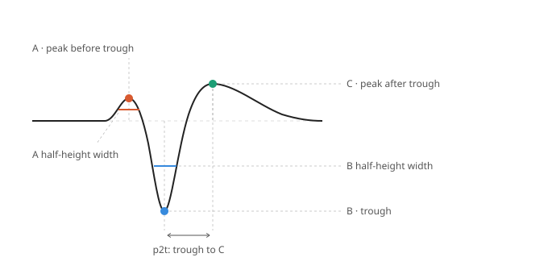
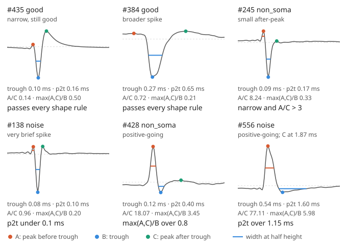

# Bombcell's waveform-shape rules, where they come from, and how they fit brainstem data

This covers the rules that label units `noise` or `non_soma` from template shape alone:
- how they're defined;
- what literature they rest on;
- whether they suit medullary (respiratory) recordings, checked against the e097 intact window (`outputs/e097/intact_window_v2`).

It complements `unit_labels_explained.md`, which covers the whole pipeline. Literature checked 2026-10-16/17. Software: SpikeInterface 0.105.2's bombcell implementation.

## What is measured

**The template.** Each unit's **mean** template (≤ 500 random spikes, −1 to +2 ms) on its main channel, upsampled 10×.

**Landmarks.**
- **B (trough):** always the most prominent *negative* dip. The waveform is never flipped for upward units.
- **A:** the positive peak before B.
- **C:** the positive peak after B.

**Measurements.**
- Heights are measured from baseline, and ratios use absolute values.
- Widths are taken at half prominence.
- **p2t** is the time from B to C.

## The rules (SpikeInterface 0.105.2 defaults)

| Rule | Unit fails if | Label |
|---|---|---|
| Waveform duration (p2t) | outside 0.1–1.15 ms | noise |
| Repolarisation peak | C / B > 0.8 | noise |
| Peak and trough counts | > 2 positive peaks or > 1 trough | noise |
| Baseline wobble, spatial decay | flatness > 0.5; decay outside 0.01–0.1 per µm | noise |
| "Axonal" compound rule | **narrow** (A width < 0.15 ms *and* B width < 0.20 ms) **and** **large ratio** (A/B > 3 *or* A/C > 3) | non_soma |
| "Axonal" main-peak rule | max(A, C) / B > 0.8 | non_soma |

- **Order:** noise is decided first. Non_soma then overrides good and mua.
- **NaN values:** a NaN noise metric counts as a fail. A NaN width counts as "narrow".

## Six e097 units (Kilosort 4)

These are the exact upsampled templates and landmarks bombcell measured, taken from `kilosort4/analyzer/extensions/template_metrics/main_channel_templates.npy` and `peaks_data.csv`.

| Unit | Label | Why |
|---|---|---|
| #435 | good | Very narrow (trough 0.10 ms, p2t 0.16 ms) but passes every rule. |
| #384 | good | Broader spike; passes every rule. |
| #245 | non_soma | Narrow, with a tiny repolarisation peak, so A/C = 8.2. The pre-peak is only a third of the trough, unlike the classic axonal shape. |
| #138 | noise | p2t is just under 0.1 ms, at SNR 33. Neighbours #135 and #136 at the same depth look alike: possibly a fibre. |
| #428 | non_soma | Positive-going, so max(A,C)/B = 3.45. |
| #556 | noise | Positive-going; C falls at 1.87 ms, so p2t = 1.60 ms. |

## Where the cutoffs come from

1. **There is no methods paper.** Bombcell is cited as software: Fabre, van Beest, Peters, Carandini & Harris (2023), Zenodo, https://doi.org/10.5281/zenodo.8172822.
2. **The peak counts, duration window and baseline flatness are the authors' empirical choices.** The author confirmed there are no references for them (bombcell issue #247, https://github.com/Julie-Fabre/bombcell/issues/247).
   - The defaults reflect the authors' mouse Neuropixels data at 30 kHz with Kilosort, mostly cortex and striatum.
   - No ground-truth tuning set is described.
   - The only region caveat is for cerebellar Purkinje cells. None covers brainstem, thalamus or spinal cord.
3. **The non-somatic rules were "inspired by" two sources.**
   - **Deligkaris et al. (2016)**, https://doi.org/10.3389/fnins.2016.00421. Dissociated rat cortical cultures on a high-density array, in vitro. Neurite spikes were narrower than somatic ones: median half-width 130 vs 250 µs, trough-to-peak 420 vs 900 µs. The distributions overlap and no ratio thresholds are given.
   - **Buzsáki, Anastassiou & Koch (2012)**, a review: https://www.nature.com/articles/nrn3241.
4. **SpikeInterface differs from native bombcell** (SpikeInterface PR #4306, https://github.com/SpikeInterface/spikeinterface/pull/4306).

   | | Native bombcell | SpikeInterface 0.105.2 |
   |---|---|---|
   | Width limits | 4 and 5 raw samples (133 and 167 µs at 30 kHz) | 150 and 200 µs, on upsampled data |
   | Pre-peak floor (keeps interneurons somatic) | A ≥ 20% of B | dropped |
   | Duration measured from | the largest extremum of either sign | always the negative trough |
   | Baseline flatness limit | 0.3 | 0.5 |
   | Minimum amplitude | 40 µV peak-to-peak | 30 µV median |

   Applying the native non-somatic rule to e097 changes little: non_soma would be 70 instead of 73 (Kilosort 4) and 81 instead of 87 (Lupin).
5. **Polarity is a known design limit.** The author calls the criteria "deliberately trough-centric" (https://github.com/SpikeInterface/spikeinterface/pull/4339#issuecomment-5998707580). A positive-dominant unit always gets max(A,C)/B > 0.8, so it is non_soma, unless a noise rule fires first.

## Brainstem evidence

- **No published widths for respiratory populations.** No extracellular spike-width distribution was found for any identified respiratory group recorded with silicon probes, Neuropixels or tetrodes: preBötC, BötC, VRG, NTS, RTN/pF, PB/KF, XII or ambiguus.
- **Many medullary units look axonal.** Bush & Ramirez (2024) recorded the medulla with Neuropixels (*Nat Neurosci* 27:259–271, https://doi.org/10.1038/s41593-023-01520-3). They classed 7,298 of 15,299 units as putatively axonal and 8,001 as somatic, using whitened waveform features with PCA and a manual boundary (after Sibille et al.), not bombcell. No widths are reported. Dense fibre tracts make genuine axonal units common.
- **Brainstem neurons are both faster and broader than cortex:**
  - Medial vestibular neurons: intracellular action-potential half-width 0.19 ms at 34 °C, 0.28 ms at 23 °C (Bagnall et al. 2007, https://pmc.ncbi.nlm.nih.gov/articles/PMC6673471).
  - Neonatal XII motoneurons and premotoneurons in slices at 27 °C: AP duration about 1.4 ms (Koizumi et al. 2008, https://pmc.ncbi.nlm.nih.gov/articles/PMC6671179).
  - Optotagged locus coeruleus units (pons): trough-to-peak 0.2–2 ms; 13 of 35 had reversed or distorted polarity (Tortorelli et al. 2022 preprint, https://www.biorxiv.org/content/10.1101/2022.08.19.504582v1). The 1.15 ms ceiling and the polarity rule would reject such neurons.
- **A pre-trough peak isn't proof of an axon.** Modelling shows somatic spikes can carry one, from axon-initial-segment current (Teleńczuk et al. 2018, https://pmc.ncbi.nlm.nih.gov/articles/PMC5987634/).
- **Positive-going units were mostly axonal in cortex.** In neocortex and CA1 they were about 4% of units and found mostly in white matter (Someck et al. 2023, https://pmc.ncbi.nlm.nih.gov/articles/PMC10507124/).
- **The cortical "narrow-spiking" convention** is a trough-to-peak under about 0.4–0.45 ms (e.g. CellExplorer, Petersen et al. 2021, https://pmc.ncbi.nlm.nih.gov/articles/PMC8602784/).

Not verified (paywalled or inaccessible): Barthó et al. 2004, Jia et al. 2019, Trainito et al. 2019, the UnitRefine preprint, Henze et al. 2000 (abstract only).

## What e097 shows

| | Kilosort 4 | Lupin |
|---|---|---|
| Median trough width | 0.12 ms | 0.12 ms |
| Negative-going units counted "narrow" | 88% | 93% |
| Good units counted "narrow" | 47 of 52 | 47 of 52 |
| Median p2t (cortical narrow cutoff ≈ 0.4 ms) | 0.24 ms | 0.19 ms |
| Negative-going non_soma (all via A/C > 3; none with A/B > 3) | 36 | 74 |
| Positive-going units that are good or mua | 0 of 129 | 0 of 26 |

**The width gate does no work here.** Almost every unit counts as "narrow", so a negative-going unit becomes non_soma through the ratio arm. In practice that is always a small repolarisation peak (A/C > 3), never the classic large pre-peak (A/B > 3). A fast somatic neuron with a weak repolarisation peak gets the same label.

**Filtering is a possible confound.** These metrics are measured on CatGT's 12th-order 300–9000 Hz output, while bombcell's defaults came from Kilosort templates. Filtering changes widths and the size of C, so the cutoffs may not be calibrated for this signal. This is plausible but untested here.

## Recommendation

- **For brainstem data, treat shape-based noise and non_soma as flags to review,** not exclusions, until they are validated.
- **In `review_units.py`, filter by:**
  - label = non_soma with criterion `peak_before_to_peak_after_ratio`;
  - polarity = positive-going;
  - label = noise with criterion `peak_to_trough_duration`.
- **What to look for:**
  - spikes that shift in time along neighbouring channels (propagation, which suggests an axon);
  - a small but present repolarisation peak;
  - refractoriness and firing pattern.
- **Ground truth would settle it:** optotagged Vglut2, Vgat, Dbx1 or ChAT units, or antidromic identification.
- **Config limits.** `curation.threshold_overrides` can switch the non-somatic rules off (set each to `null`). Positive-going units would still fail the noise rules, because the template is never flipped. Handling them properly needs a code change.
